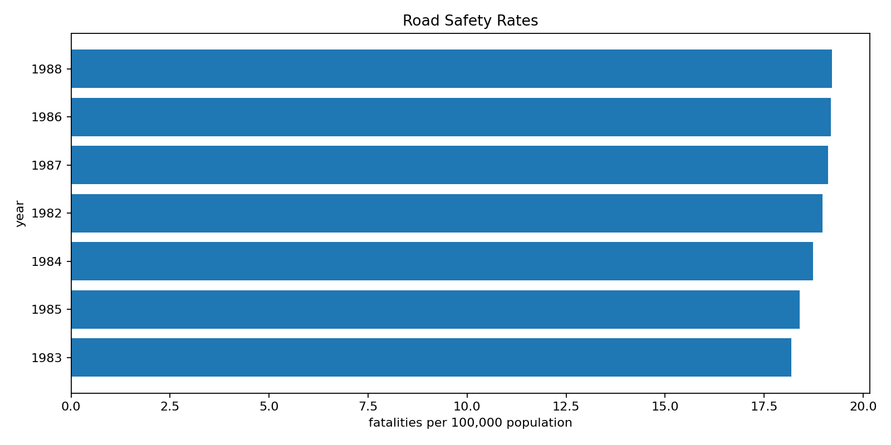

# 28. Road Safety Rates

**Question:** How do population-weighted road fatality rates change by year?

**Audience:** An analyst or decision maker reviewing road safety rates.

## Workflow
1. Read the source data dictionary and establish the observation grain.
2. Acquire public CSV data and record a SHA256 provenance hash.
3. Audit types, missingness and duplicates; preserve legitimate repeated measurements.
4. Analyse using SQLite and Python; export results and visualisations.
5. Review the executed report, limitations and proposed next action.

## Run
From this project directory, after installing requirements.txt:
```bash
python analysis.py
jupyter lab analysis.ipynb
```
Run notebook cells from top to bottom. The script downloads data if its local cache is absent. Open outputs/dashboard.html for the static dashboard.

## Sources and definitions
[CSV](https://vincentarelbundock.github.io/Rdatasets/csv/AER/Fatalities.csv) · [Data dictionary and provenance](https://vincentarelbundock.github.io/Rdatasets/doc/AER/Fatalities.html)

Variables used: `year` and `fatal`. Consult the linked dictionary for units, date coverage, study design and sampling. Population-weighted annual rate = 100,000 × total fatalities / total population.

## Limitations
Rate uses summed fatalities divided by summed population, per 100,000; states repeat over years.

## Deliverables
- Executed notebook with tables and figures
- Runnable Python pipeline and SQLite SQL
- Missingness audit, numeric summaries, result CSV, chart images
- Static HTML dashboard and evidence-based report
- Run manifest with row counts, versions and source hash

## Licensing and publication
Code is provided under the MIT licence in LICENSE. Source data remains subject to the original dataset terms. Raw datasets and SQLite databases containing row-level records are excluded from the release archive. Read the source documentation and confirm redistribution terms before adding raw or cleaned records to a public repository. No original data authorship is claimed.

[Executed results](outputs/REPORT.md)

## Install and execute

```bash
python -m venv .venv
# Linux/macOS
source .venv/bin/activate
# Windows PowerShell: .venv\Scripts\Activate.ps1
pip install -r requirements.txt
python analysis.py
```

## Verified result
2026-11-21T10:14:15.679460+00:00 — executed on real source data. SQL calculations were cross-checked independently against pandas. Notebook cells were executed sequentially through IPython in-process; standard Jupyter kernel startup was blocked by the build environment.



This is a descriptive portfolio case study, not a paid client engagement or production deployment. The HTML dashboard is static. Download it with its chart images to view locally.
