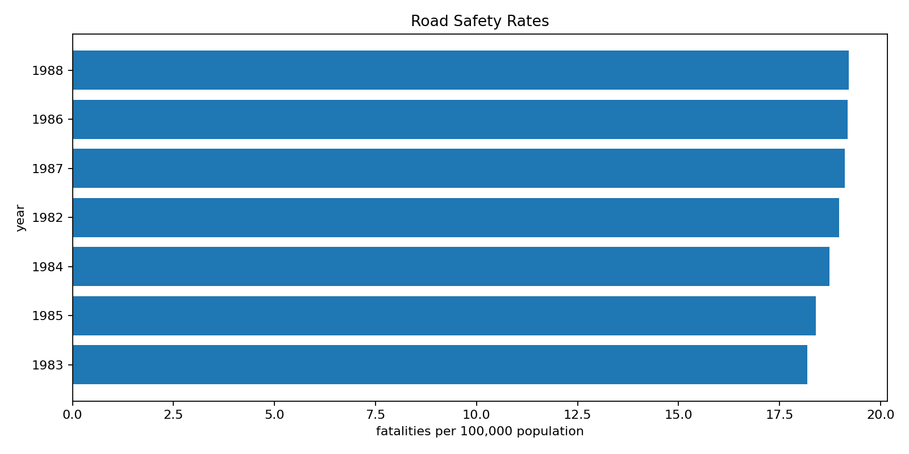

# Road Safety Rates — executed results

## Decision question
How do population-weighted road fatality rates change by year?

## Evidence
The largest observed fatalities per 100,000 population is 19.209 for 1988.0. This ranking is descriptive, not a recommendation.

Raw rows: 336. Rows used: 336. Excluded for missing/nonfinite required values or invalid denominator: 0.

## Method
Population-weighted annual rate = 100,000 × total fatalities / total population.

## Interpretation and limitations
Rate uses summed fatalities divided by summed population, per 100,000; states repeat over years. No causal inference, significance claim or production deployment is implied. Missing values are not imputed; identical rows are retained. Small or repeated samples limit uncertainty interpretation.

## Recommended next decision
Check exposure in vehicle miles and state-level differences.

## Reproducibility
Source and exact downloaded-byte SHA256 are recorded in run_manifest.json. SQL results are in answer.csv and analysis.sqlite. Review quality_audit.csv before interpretation.
